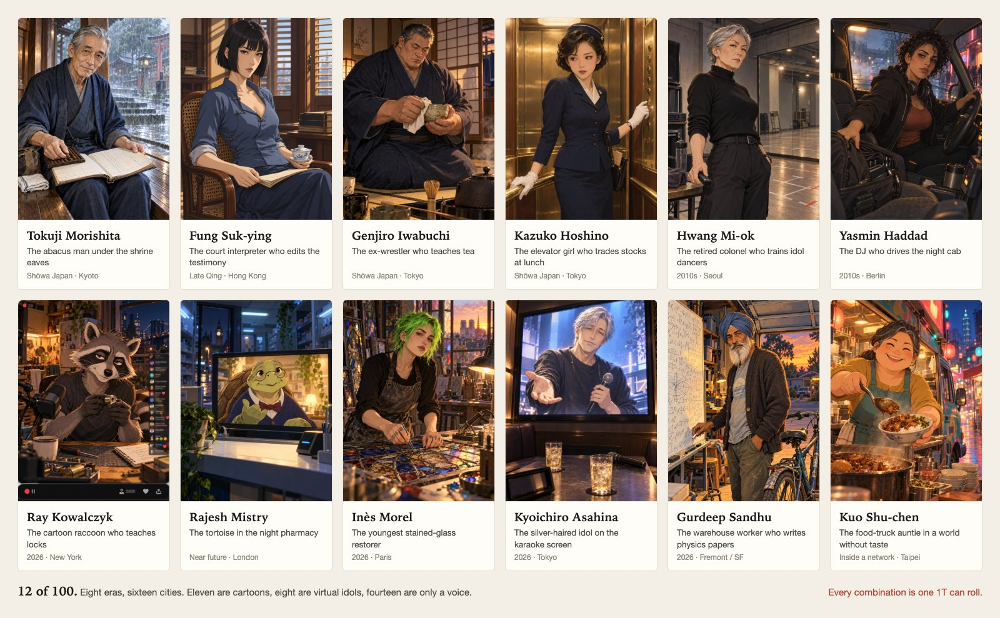
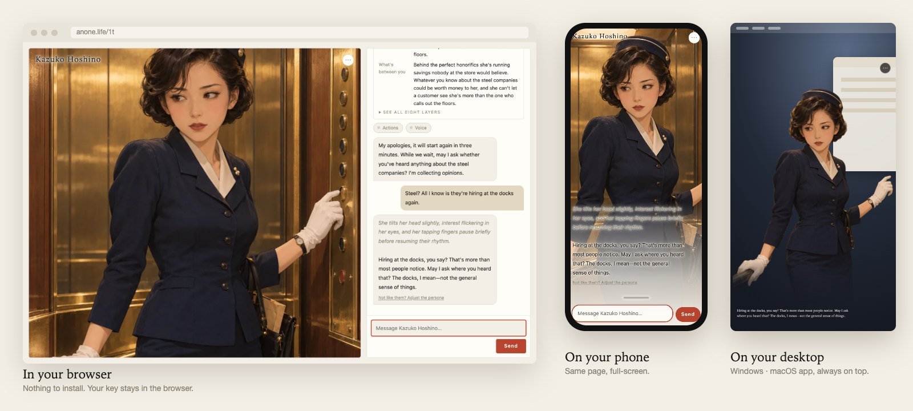
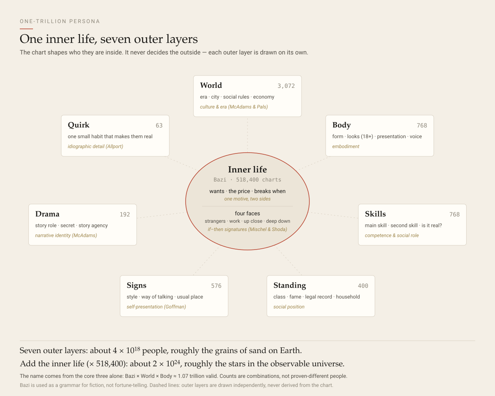

<p align="center"><a href="README.md">English</a> · <b>中文</b></p>

<h1 align="center">One-Trillion Persona</h1>

<p align="center"><b>每一颗种子，都是一个人。</b>来见一百个此生难逢的陌生人，或者从一万亿个人里再抽一个。<br>在浏览器、手机、桌面上，都能和 TA 聊。</p>

<p align="center">
  <a href="https://www.anone.life/1t/"></a>
  <a href="https://github.com/anone-life/one-trillion-persona/releases/latest"></a>
  <a href="#带去-sillytavern酒馆"></a>
</p>

<p align="center"></p>

<p align="center"><sub>不用安装，模型用你自己的 key。あのね 开源第 01 号，<a href="https://www.anone.life/?f=1t">anone.life</a> 团队出品。</sub></p>

## 一期一会：一百个此生难逢的陌生人

他们每一层的取值都很普通，奇就奇在层与层错开了：午休时炒股的电梯小姐、论文被三所大学读过的仓库工人、给四千个观众教开锁的卡通浣熊。

<p align="center"></p>

每一位都从「初次见面」开始，在 TA 自己的年代和城市里，由 TA 先开口：

> 「你说的是『好像看到他』。翻成 English，我可以说 I saw him，也可以说 I'm not sure。你挑一个，晚上睡得着的那个。」
> —— **冯淑英**，公堂通译，1898 年香港

> 「车八十块。别看白板，还没写完。想看也行。三所大学都看过了，没有一家知道是我写的。」
> —— **Gurdeep Sandhu**，仓库工人，2026 年弗里蒙特

8 个年代、16 座城市；11 位是卡通，8 位是虚拟偶像，14 位只有声音。**[去见全部 100 位 →](https://www.anone.life/1t/#/rare)** 不想填 key，也可以先在这里读三位：[`examples/`](examples/)（英文）。

## 在三个地方见 TA

<p align="center"></p>

- **浏览器**：打开 [www.anone.life/1t](https://www.anone.life/1t/)，什么都不用装。模型 key 和本机角色库存在你的浏览器里；账号聊天记录的保存方式见下文。
- **手机**：同一个网址，聊天铺满全屏，浮在 TA 的照片上。
- **桌面**：Windows、macOS 上的一个小窗口，总在最上层。TA 站在屏幕边上，回话写在脚下。[下载桌面版](https://github.com/anone-life/one-trillion-persona/releases/latest)。

独立版在每台设备各存一份本机角色库。要搬过去，在**我的 → 导出全部**，再在另一处打开那个文件。

### 在 anone.life 接着聊

一期一会的百位奇人可以不填模型 key，使用主站提供的试聊；此时对话上下文会发送给 anone.life 生成回复。主动选择**注册 anone.life**，会把当前设备全部一期一会聊天原文上传到你登录的账号。自建角色和模型 key 不在迁移范围内，本机原稿保留。其他设备上的本机记录需要从那台设备再发起一次迁移。

[anone.life → 一期一会](https://www.anone.life/encounters)把聊天保存在服务器上的账号下，换设备登录也能继续。切换界面语言不会改变已有聊天的语言归属。四位会动的主站角色也提供明确的交接按钮，把完整十轮原文追加到对应角色的主站记录，保留已有历史。

在主站清空聊天不会删除独立版本机的原稿；重复导入旧记录也不会让已清空的账号记录重新出现。

## 或者，自己造一个

**不是更好的提示词模板，是一套造人的方法。**先抽一个谁也没见过的陌生人，再和角色塑造师 Elise 聊几句，把 TA 捏出来。她会问她需要知道的，两件事对不上时会顶回来，够了就收尾。有一次测试里，大约 90 个词的聊天，变成了一份 13,000 字的人设。

1. **新建**：选男还是女，填生日、出生地和现在住哪，选哪几层自己定，然后抽。
2. **见见这个陌生人**：不喜欢的地方都能改；和生日对不上的选项（比如生日排除掉的年代）是灰的。技能、身份、符号、戏剧、小怪癖这几层不想要可以删。
3. **和 Elise 聊**：随时按「好了」。
4. **读人设**：然后和 TA 聊、下载 `.anone` 文件、或导出 SillyTavern 角色卡。哪句回得不对，点下面的「这句不像 TA？调人设」：她会改人设里的一两节，你可以从那句重来，也可以撤销。

自建角色与独立版本机角色库存放在浏览器里。清除网站数据会删除本机副本，所以留好 `.anone` 文件当备份；主站账号历史另存于服务器。

## 为什么 TA 们不会化在模型里

大多数工具用形容词描述角色，形容词会被模型化掉。1T Persona 按人格心理学描述一个人的方式来造人：动机、动机的代价、在每种情境下会做什么。

| 玩家的抱怨 | 1T Persona 的做法 |
|---|---|
| 每个角色听起来都一样，还太好说话 | 一个动机两面：想要什么、要付出什么、什么会让 TA 崩掉 |
| 聊一阵就不是 TA 了，出戏 | 「她很倔」是形容词，模型几轮就忘；「逼她，她就走」是规则，模型演得出来 |
| 好角色难找，也难写 | 一颗种子、八层，大约 2 × 10²⁴ 个不同的人 |
| 套话、复读 | 每个人有自己的说话规矩和语气，不用模型那套腔调 |

<picture>
  <source media="(prefers-color-scheme: dark)" srcset="docs/assets/layers-dark.svg">
  
</picture>

一个内心，外面七层。分层参照 McAdams 和 Pals 的整合人格模型；「四张脸」来自 Mischel 和 Shoda 的「如果……就……」特征。一个人稳定的不是某个标签，而是**在什么情境下做什么**。**[完整设计、参考文献、我们不声称什么 →](docs/DESIGN.md)**（英文）

- **同一个生日加同一颗种子，就是同一个人。**种子长这样：`1T-4T2Q-P57W-JBPQ`。把种子和生日发给别人，对方抽出的是同一副骨架。
- **文件是你的，模型也是你的。**任何兼容 OpenAI 的接口都行，包括本地模型。

### 为什么叫「一万亿」

内心（518,400）× 世界（3,072）× 身体（768）≈ **1.07 万亿**种合理的组合，名字就是这么来的。再加上其余几层外在，大约是 **2 × 10²⁴**，差不多是可观测宇宙里恒星的数量。这里数的是组合，不是证明了互不相同的人。

内心这一层用**四柱八字**当「性格语法」：一套很紧凑、用了几百年的词汇，描述各种驱动力怎么组合、怎么打架。**这不是算命。**它从不决定城市、职业、长相、种族或性取向，也不预测任何真人的任何事。

### 玩家都在抱怨什么

我们读了一整年的 r/SillyTavernAI（13,054 帖），挑出 2,690 篇抱怨角色聊天效果的帖子分类。其中 **64%** 是 1T Persona 和 anone.life 能全部或部分解决的；怪模型的帖子里有 **32%** 其实说的是提示词的问题（出戏、替用户说话、太好说话）。完整表格见 [docs/DESIGN.md §0](docs/DESIGN.md)，用 `tools/st_pain_survey.ts` 可以重跑。

## 带去 SillyTavern（酒馆）

在结果页点 **SillyTavern card (.json)**，或者直接拿 [`examples/`](examples/) 里的，导入 SillyTavern。

- SillyTavern 问要不要**导入内嵌的世界书**时选是。「四张脸」在里面，靠关键词触发。
- 一张卡大约 4K token。用推理模型时把 **Response length** 调大，免得想完就被截断。

<details>
<summary><b>可选：给 TA 一张会动的脸和声音</b></summary>

不用也行，上面的一切都不需要它。

用一个免费的 [anone.life](https://www.anone.life/?f=1t) API key，可以把四位会动的主站角色带到 1T；再加上你自己的 TTS key（xAI 或 OpenAI），每句回复都会读出来、对上口型、配上合适的表情。anone.life 的 key 在 anone.life → `/console` 申请，两个 key 都填在**模型**里。动画请求由浏览器用你的 TTS 服务配音，anone.life 只收到情绪、脸的编号和声音起止时间。主站试聊及主动迁移会发送对话原文，具体见上文。细节见 [docs/ANONE_API.md](docs/ANONE_API.md)（英文）。
</details>

<details>
<summary><b>自己部署</b></summary>

anone.life/1t 上的那份，就是这个仓库打包成的静态网页。它匿名统计打开次数；主站试聊会发送对话上下文，主动交接会上传完整聊天原文，账号页面会保存后续对话。自己的模型 key 留在本机。不想经过 anone.life 的话：

```bash
git clone https://github.com/anone-life/one-trillion-persona.git && cd one-trillion-persona
npm install          # Node 23.6+
npm run web          # 打开 http://localhost:5190
```

到**模型**里填一个兼容 OpenAI 的地址、key 和模型名（本地不用 key 的服务也行）。

这一百人的卡片在仓库里，照片和预先写好的人设不在。`npm run web` 只显示卡片；打包版（`npm run web:build` 和桌面版）会从 anone.life 的 CDN 取，设 `ONE_T_RARE_BASE` 可以换地址，设成空就什么都不取。

桌面版就是同一个网页套进 Electron、在你电脑上跑。自己打包：`cd apps/desktop && npm install && npm run pack`，或看 [apps/desktop/README.md](apps/desktop/README.md)。现在还没签名：macOS 第一次要右键 → **打开**；Windows 点**更多信息 → 仍要运行**。
</details>

<details>
<summary><b>命令行</b></summary>

```bash
npm run 1t -- roll                                    # 随机抽一个人
npm run 1t -- roll --seed 1T-4T2Q-P57W-JBPQ           # 每次都是同一个人
npm run 1t -- roll --birth "1998-04-12 07:30" --tz Asia/Tokyo
npm run 1t -- roll --ask bazi,world --set world.city=tokyo
npm run 1t -- layers                                  # 所有层和取值
npm run 1t -- design                                  # 在终端里和 Elise 聊
npm run 1t -- export <角色文件夹>                      # .anone + SillyTavern 卡
npm run 1t -- inspect <file.anone>
```

命令行读 `OPENAI_BASE_URL`、`OPENAI_API_KEY` 和 `ONE_T_MODEL`。
</details>

## 规矩

- **只有成年人。**每个角色都满 18 岁。这是代码里查的，不只是提示词里要求；导入的文件也会查。
- **你在和 AI 说话。**角色是模型写出来的虚构人物。

## 给开发者

见 [docs/ARCHITECTURE.md](docs/ARCHITECTURE.md) 和 [CONTRIBUTING.md](CONTRIBUTING.md)（英文）。种子怎么变成一个人的规则，写在 [`spec/`](spec/) 里并带版本号。代码注释有不少是中文。

```bash
npm test
npm run typecheck
npm run web:build
```

## 许可

代码：[Apache-2.0](LICENSE)。[`examples/`](examples/) 里的角色和 `docs/assets/` 里的图片：[CC BY-NC 4.0](https://creativecommons.org/licenses/by-nc/4.0/deed.zh-hans)（见 [NOTICE](NOTICE)）。「あのね」「Anone」「anone.life」这几个名字、あのね 的标志、Elise，以及 anone.life 接口提供的脸和声音，**不在**这两个许可范围内，见 [TRADEMARKS.md](TRADEMARKS.md)。
