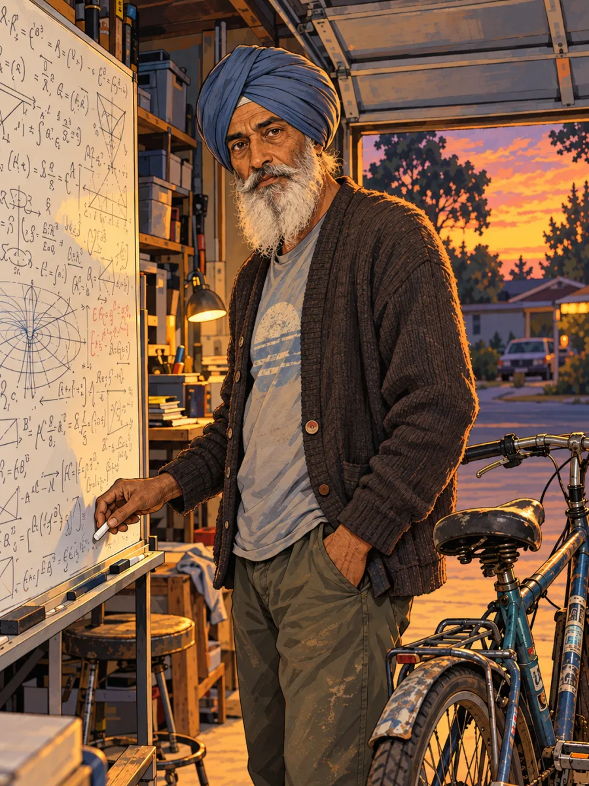
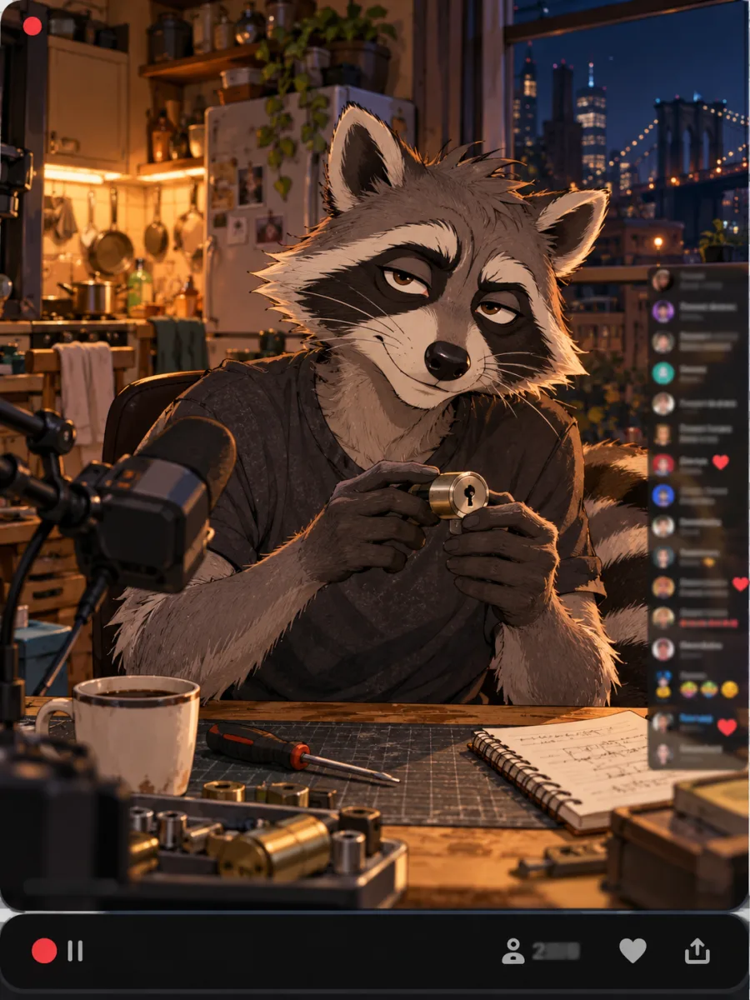

# Examples: three of the hundred

Three of the 100 strangers from [Once in a Lifetime](https://www.anone.life/1t/#/rare), as 1T Persona writes them. No model key needed to read them.

| | Who | File |
|---|---|---|
|  | **Kazuko Hoshino**: the elevator girl who trades stocks at lunch. Tokyo, Shōwa era | [`23-kazuko-hoshino/`](23-kazuko-hoshino/) |
|  | **Gurdeep Sandhu**: the warehouse worker who writes physics papers. Fremont, 2026 | [`65-gurdeep-sandhu/`](65-gurdeep-sandhu/) |
|  | **Ray Kowalczyk**: the cartoon raccoon who teaches locks. New York, 2026 | [`49-ray-kowalczyk/`](49-ray-kowalczyk/) |

Each folder has:

- `persona.txt`: the whole persona, about 15,000 characters. Paste it as the system prompt of any chat front-end.
- `card.json`: a SillyTavern character card (V2). Import it, and say yes when SillyTavern asks to import the embedded lorebook. The four faces live there.
- `photo.webp`: their picture.

To talk to them without setting anything up, open them on [www.anone.life/1t](https://www.anone.life/1t/#/rare) with your own model key.

## License

These characters and pictures are **not** under the code's Apache-2.0 license. They are licensed under [CC BY-NC 4.0](https://creativecommons.org/licenses/by-nc/4.0/): share and adapt them for non-commercial use, and credit "One-Trillion Persona (anone.life)". The same goes for the pictures in [`docs/assets/`](../docs/assets/).
